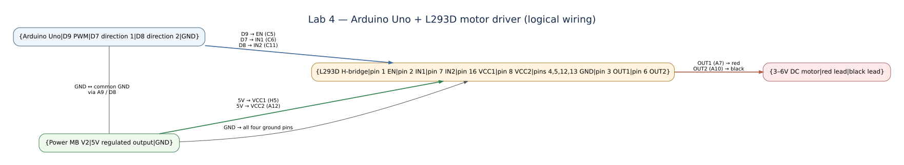

# Arduino DC Motor Control | L293D H-Bridge + PWM

**Pre-Mechatronics — Lab 4** · ELEGOO UNO R3 starter kit · Hands-on laboratory and portfolio project

**Status: Complete — electrical experiments and refactored controller hardware-validated.**

## Project overview

Built and measured an Arduino-controlled brushed DC motor circuit using an L293D H-bridge and a separately regulated 5V supply. Demonstrated motor enable/disable, electronic direction reversal, and variable-speed PWM operation. Logged voltage measurements to compare commanded duty cycle with the DC multimeter's motor-terminal readings.

**Demonstrated outcomes:** Motor rotated in both commanded directions; motor terminal polarity changed from **+3.39V** (forward) to **−3.39V** (reverse) without swapping motor leads. PWM increased apparent speed. The motor supply measured **5.00V at standby** and **4.94V** during a short **75% PWM** run. A subsequent serial-controlled sketch was validated on the assembled circuit for forward/reverse operation, PWM selection, timed shutdown, and commanded stopping.

## Hardware

- Arduino Uno R3, powered from computer USB
- L293D dual H-bridge IC, first channel used
- ELEGOO Power MB V2 module, independently powered by a 9V DC center-positive adapter
- Kit's 3–6V brushed DC motor and fan blade
- Breadboard, jumpers, DMM and clip adapters

The motor-driver logic supply and motor supply were both connected to the **power module's regulated 5V output**, with a common ground to the Arduino. **Do not connect the module's 9V input directly to the motor, or feed its regulated 5V output into the Arduino 5V pin.** Supply current rating is not a substitute for checking actual motor current and thermal limits.

## Wiring



| Arduino / supply | L293D pin | Breadboard position | Role |
|---|---|---|---|
| Arduino D9 | 1 | E5, jumper C5 | Enable / PWM |
| Arduino D7 | 2 | E6, jumper C6 | Direction input 1 |
| Arduino D8 | 7 | E11, jumper C11 | Direction input 2 |
| Power MB V2 +5V | 16 | F5, jumper H5 | Logic supply VCC1 |
| Power MB V2 +5V | 8 | E12, jumper A12 | Motor supply VCC2 |
| Common ground (module and Arduino) | 4, 5, 12, 13 | E8, E9, F9, F8 | L293D ground pins |
| Motor red | 3 | E7, jumper A7 | Motor output 1 |
| Motor black | 6 | E10, jumper A10 | Motor output 2 |

**Reference:** IC notch faces breadboard row 5; IC spans E5–E12 and F5–F12 across the trench. This is a *logical wiring diagram*, not a to-scale breadboard layout. Confirm orientation and available holes before wiring.

## Recorded experiments

### H-bridge direction reversal

| Direction command | D7 (IN1) | D8 (IN2) | Voltage from motor red lead to black lead |
|---|---|---|---:|
| Forward | HIGH | LOW | +3.39 V |
| Reverse | LOW | HIGH | −3.39 V |

Changing direction inputs inverted the motor-terminal polarity without rewiring the motor. The original fan rotation direction was difficult to judge visually, which motivated this electrical verification.

### PWM and observed rotation

| `analogWrite` | Duty cycle (approx.) | DMM motor-terminal reading | Observation |
|---:|---:|---:|---|
| 64 | 25% | +0.364 V | Barely rotating during voltage test |
| 128 | 50% | +1.74 V | Moderate rotation |
| 191 | 75% | +2.50 V | Noticeably faster than 50% |
| 255 | 100% | +3.39 V | Fastest observed |

**Interpretation:** Commanded duty cycle correlated with higher displayed terminal voltage and greater apparent rotation speed. These are **DC multimeter readings of a switched, inductive motor load**, not direct measurements of PWM pulse amplitude, true cycle-averaged voltage, RPM, or mechanical output power. Results across test runs may depend on the motor's speed, load, settling time, and meter characteristics. The +3.39 V 100% datum comes from a separate forward-direction experiment.

### Supply regulation during short PWM test

| Condition | VCC2-to-GND reading |
|---|---:|
| Motor stopped | 5.00 V |
| Motor running at 75% PWM | 4.94 V |
| Observed voltage reduction | 0.06 V (1.2%) |

This short test indicates reasonably stable measured supply voltage *during the sample*, but **does not establish startup-current peaks, motor stall current, continuous-load performance, or regulator thermal margins**.

Raw entries are provided in [`data/measurements.csv`](data/measurements.csv).

## Portfolio sketch (hardware-validated)

Source: [`arduino/Lab4_DC_Motor_Control/Lab4_DC_Motor_Control.ino`](arduino/Lab4_DC_Motor_Control/Lab4_DC_Motor_Control.ino).

The refactored portfolio sketch replaces repeated edits and uploads with explicit commands using the Arduino IDE **Serial Monitor at 115200 baud**. The motor **does not start automatically on reset**. Set the direction and duty, then send `g` to start one *maximum three-second* pulse. Send `s` to stop during the pulse. The sketch is designed to prevent speed and direction changes while the motor is running.

| Serial command | Action |
|---|---|
| `f` / `r` | Select forward or reverse |
| `1` / `2` / `3` / `4` | Select ~25% / ~50% / ~75% / 100% duty |
| `g` | Start one timed pulse (max 3 seconds) |
| `s` | Stop the motor in software |
| `?` | Help and current status |

**Code provenance:** This refactored sketch was tested *after* the electrical measurements above; it is not the exact sketch used to collect those measurements. The software stop and three-second timeout are **not safety-rated emergency-stop mechanisms**. The power switch/disconnect is the physical means of de-energizing the motor.

### Hardware validation results

The revised sketch was compiled, uploaded, and exercised with the Arduino Uno, L293D driver, and motor connected. The following observations were recorded through the Arduino IDE Serial Monitor and direct observation of the motor:

| Test | Observed behavior | Result |
|---|---|---|
| Safe startup | Motor remained stationary after reset and after external motor supply was switched ON | Passed |
| PWM selection | `1` selected `64/255` (~25%); `3` selected `191/255` (~75%) without starting the motor | Passed |
| Direction selection | `r` and `f` updated direction while motor remained stopped | Passed |
| Stop command, idle | `s` returned `STOP command: motor disabled.` | Passed |
| Reverse pulse at 25% | Motor rotated slightly; pulse ended automatically after approximately three seconds | Passed |
| Reverse pulse at 75% | Motor ran; `s` interrupted the pulse before its three-second timeout | Passed |
| Forward pulse at 75% | Motor rotated opposite to reverse; stopped automatically after approximately three seconds | Passed |
| Serial status output | RUNNING, STOPPED, start, stop, and pulse-finished messages were observed during tests | Passed |

**Example forward test (75% PWM):**

```text
Motor pulse started (max 3 seconds).
Direction: forward | PWM: 191/255 | Motor: RUNNING
Pulse finished; motor disabled.
```

**Example commanded stop (75% PWM, reverse):**

```text
Motor pulse started (max 3 seconds).
Direction: reverse | PWM: 191/255 | Motor: RUNNING
STOP command: motor disabled.
```

### Controller conclusions and limits

The validated controller independently accepted direction and duty-cycle selections, performed short commanded motor runs, automatically disabled output after its timer expired, and accepted a stop command during an active pulse. This demonstrates basic serial command processing, discrete control states, PWM-based actuation, and timed operation.

The validation was **functional, not exhaustive**. It did not measure exact stop latency, PWM waveform shape, motor RPM, motor current, or fault behavior under all operating conditions. The initial Serial Monitor output included a brief sequence of garbled characters and `Unknown command` messages before the readable startup menu; subsequent commands worked normally. This startup anomaly remains available for future troubleshooting.

### Safe operation and test procedure

1. With USB and external power disconnected, inspect wiring, motor clearance, and common ground. Keep motor power OFF while uploading.
2. Upload the sketch to the Uno and open Serial Monitor at **115200 baud**. Confirm the motor is stopped on startup.
3. Switch ON the separate motor supply and verify the motor remains stationary.
4. Select direction (`f` or `r`) and duty (`1`–`4`) while stopped. Send `g` to start one pulse; observe automatic three-second shutdown.
5. In a separate pulse, send `s` while the motor is running to verify commanded stopping. For abnormal behavior, use the **physical supply switch/disconnect**, not the serial command.
6. Switch OFF the module and disconnect its adapter and Arduino USB before rewiring or changing measurement connections.

## Troubleshooting and engineering lessons

- **Unstable readings:** Damaged/loose alligator clip adapters caused uncertain contact; replaced them before proceeding with powered measurements.
- **Arduino 5V rail:** Earlier computer USB supply measured ~4.43–4.46 V at the Uno 5V pin. A 9V barrel-jack adapter yielded ~5.02 V at the Uno 5V pin, but powering the motor through the onboard 5V regulator was avoided.
- **Driver output voltage loss:** At 100% duty, motor terminals measured ±3.39 V with a nominal 5 V supply. The L293D's bipolar output stage can drop significant voltage. This is not an exact driver-drop measurement because supply voltage and motor voltage were not sampled simultaneously under the same conditions.
- **25% duty cycle:** The fan barely rotated in the three-second measurement test, illustrating startup torque and load sensitivity. The original short speed test described slow rotation.
- **Motor resistance:** Initial disconnected winding readings depended on rotor position; poor probe contact also caused erratic readings. Winding resistance alone does not determine motor's rated voltage.

## Next improvements

- Measure actual motor speed with an optical or encoder-based method; compare RPM vs. duty cycle.
- Measure motor current safely with a suitable measurement method and characterize loaded voltage at multiple duty cycles.
- Add a labeled photograph of the finished circuit and a fully verified breadboard diagram.

## Safety

This is an educational, low-voltage demonstration, not a production motor controller. Keep USB and external module power disconnected for rewiring; never measure resistance or continuity on an energized circuit; never place a multimeter in current mode across supply or motor outputs. Secure fan blades, clips, and jumpers. Disconnect immediately for unexpected heating, dimming, smoke, or uncontrolled movement.
